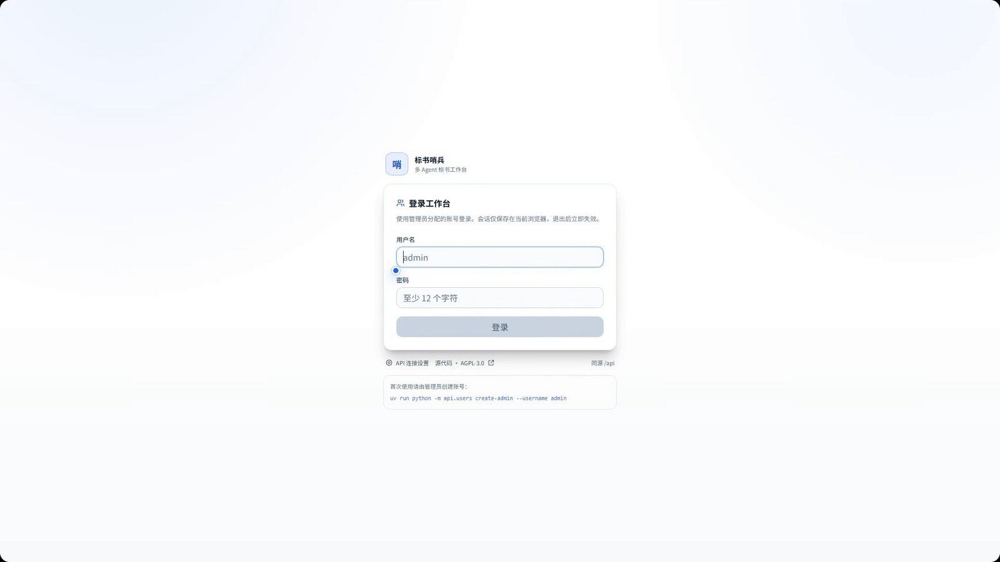
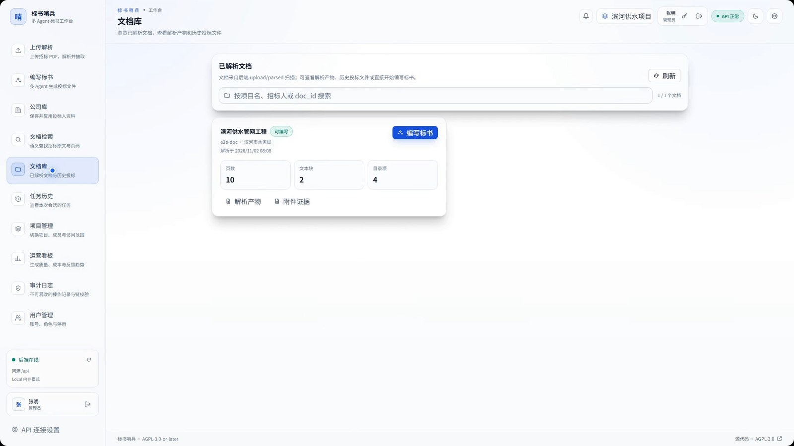
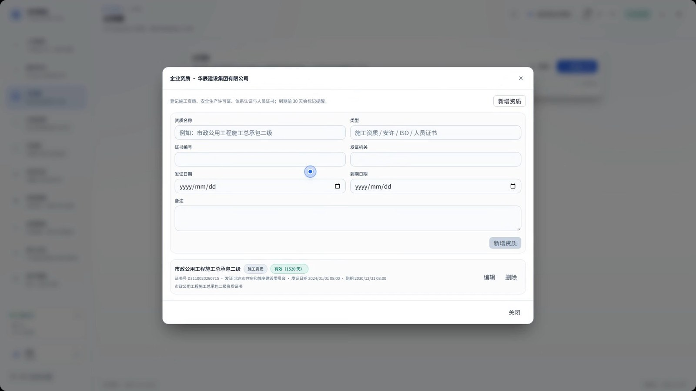
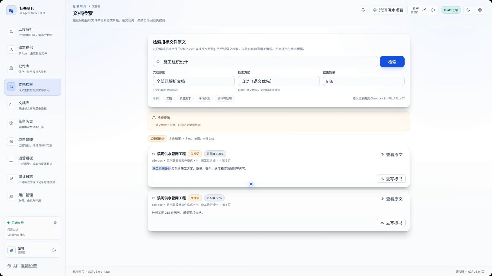
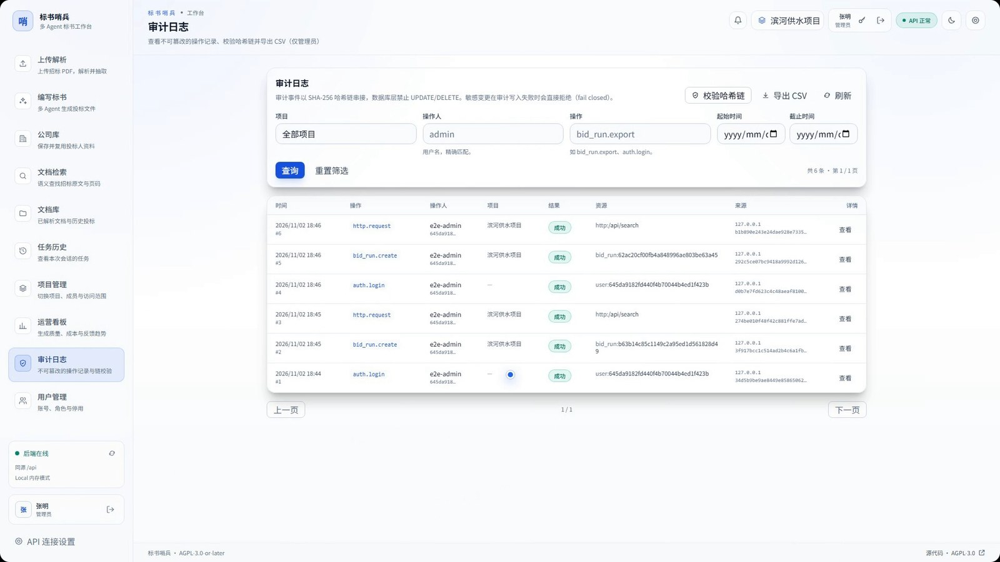

# Much Agents · 标书哨兵

[](https://github.com/lj105183000/much-agents/actions/workflows/ci.yml)

标书哨兵（Much Agents）是多 Agent 标书编写系统：把招标文件 PDF 解析为结构化知识，检索相关章节，由多个 Agent 生成投标文件，并完成合规检查、跨章节一致性核对、AI 配图与严格门禁导出。

[项目主页](https://lj105183000.github.io/much-agents/) · [▶ 观看产品演示（约 74 秒，中文旁白，含字幕）](https://lj105183000.github.io/much-agents/presentation/) · [产品介绍 PDF](https://github.com/lj105183000/much-agents/releases/download/v0.2.0/biaoshu-shaobing-product-intro.pdf) · [PPTX](https://github.com/lj105183000/much-agents/releases/download/v0.2.0/biaoshu-shaobing-product-intro.pptx) · [源码](https://github.com/lj105183000/much-agents) · [生产验收边界](docs/m1-acceptance-report.md)

**产品前端界面**（截图来自同一演示环境，使用合成演示数据）

|  |  |
|---|---|
| **登录工作台**<br>[](docs/presentation/screenshots/login.jpg) | **文档库**<br>[](docs/presentation/screenshots/document-library.jpg) |
| **编写标书与大纲**<br>[](docs/presentation/screenshots/bid-outline.jpg) | **企业资质**<br>[](docs/presentation/screenshots/company-qualifications.jpg) |
| **文档检索**<br>[](docs/presentation/screenshots/document-search.jpg) | **审计日志**<br>[](docs/presentation/screenshots/audit-log.jpg) |

> 本项目以 GNU Affero General Public License v3.0 or later（AGPL-3.0-or-later）发布。

## 目录

- [主要能力](#主要能力)
- [快速开始](#快速开始)
- [架构](#架构)
- [Agent 工作流](#agent-工作流)
- [RAG 与防幻觉](#rag-与防幻觉)
- [知识库](#知识库)
- [安全边界](#安全边界)
- [测试与检查](#测试与检查)
- [文档](#文档)
- [状态与未实现项](#状态与未实现项)
- [License](#license)

## 主要能力

- **文档解析**：MinerU 云端解析（PyMuPDF 兜底）、目录/页码对齐、表格与页脚清理、DeepSeek 结构化抽取、向量入库。
- **检索**：Chroma 语义检索，Chroma/智谱不可用时自动回退关键词检索。
- **多 Agent 写作**：3 个核心 Agent（Writer/Reviewer/Reviser，见下文「Agent 工作流」）；确定性大纲 → 逐节检索 → 并行写作 → 审查 → 条件修订 → 组装；支持可编辑大纲、章节续跑、单节编辑与重写。
- **质量与门禁**：21 项合规检查、跨章节一致性台账、确定性/LLM 修复方案、导出前门禁与严格 DOCX 导出。
- **AI 配图**：组织架构、工艺流程、进度横道、施工总平面；只使用招标事实与已脱敏正文，不文生图、不编造事实。
- **认证与隔离**：本地账号、可撤销会话、5 角色 RBAC、项目级 ACL、append-only 审计哈希链。
- **桌面与 Web**：React 19 + Vite + Electron 工作台；Nginx 生产托管与 API 反向代理。
- **MCP**：MCP 服务端（stdio/HTTP）与白名单客户端（外部证据、企业资料、外部绘图）。
- **生产运维**：Docker Compose、TLS、健康检查、备份/恢复脚本、CI 与安全扫描。

## 快速开始

### 依赖

- Python 3.12（由 `uv` 管理）
- Node.js 22+
- Docker Desktop（PostgreSQL/Redis/MinIO；Chroma 可本机运行）
- 模型密钥：`DEEPSEEK_API_KEY`、`ZHIPU_API_KEY`、`MINERU_API_KEY`

### 一键启动（Windows，推荐）

```text
start.bat            # Docker 依赖 + 迁移 + Chroma + API + worker + Vite
start.bat local      # 无 Redis/worker/MinIO 的本地模式
start.bat prod       # 构建前端并由 Nginx 托管到 8080
stop.bat             # 停止 start.bat 拉起的进程
```

首次运行会从 `.env.example` 复制 `.env`；缺少模型密钥时只警告，不阻塞启动。

### 手动启动后端

```bash
uv sync
cp .env.example .env            # 填写模型密钥；.env 永不入库
uv run alembic upgrade head     # 应用 PostgreSQL 迁移
uv run chroma run --path ./chroma_db
uv run uvicorn api.main:app --host 0.0.0.0 --port 8001
```

默认使用 Celery + Redis；Windows worker 必须 `--pool=solo`：

```bash
uv run celery -A api.celery_app:celery_app worker -Q parse,bid --pool=solo --loglevel=INFO
```

无 Redis/worker 的本机模式：

```bash
TASK_BACKEND=local uv run uvicorn api.main:app --port 8001
```

首次使用需创建管理员：

```bash
uv run python -m api.users create-admin --username admin --display-name 管理员
```

### 手动启动前端

```bash
cd frontend
npm install
npm run dev          # http://localhost:5173
npm run electron:dev # Electron + Vite
```

### 生产部署

```bash
docker compose -f docker-compose.prod.yml up -d --build
```

生产只通过 Nginx 暴露 80/443；API/worker 非 root、只读根文件系统。部署前请阅读
[`docs/deployment.md`](docs/deployment.md)，并使用 `deploy/env.production.example`
与真实 TLS 证书。`ENVIRONMENT=production` 会在启动时拒绝不安全配置。

## 架构

```text
PDF ──► 解析/抽取 ──► Chroma 向量库 ──► 多 Agent 写作 ──► 合规/一致性/门禁 ──► DOCX
                                      │
                    FastAPI + Celery + PostgreSQL + Redis + MinIO
                                      │
                              React / Electron 工作台
```

| 目录 | 内容 |
|---|---|
| `api/` | FastAPI 路由、认证/RBAC、投标 run、审计、MCP 服务端 |
| `src/parsing/` | PDF 解析、结构对齐、抽取、分块、入库 |
| `src/bidding/` | LangGraph 写作、大纲、合规、一致性、修复方案、配图 |
| `src/storage/` | 本地 / MinIO 对象存储与 hydration |
| `src/mcp_client/` | 白名单 MCP 客户端 |
| `migrations/` | Alembic 迁移（`0001`–`0027`） |
| `frontend/` | React 19 + TypeScript + TailwindCSS 4 + Electron |
| `deploy/` | Nginx/TLS、生产 Compose 环境模板 |
| `scripts/` | 一键启动、备份/恢复、worker 健康检查、E2E 编排、压测、LLM 基准与成本对账 |
| `docs/` | 认证、项目 ACL、审计、对象存储、部署、AI 配图/MCP、E2E/压测 |
| `tests/` | 后端单元/接口测试（全部 mock 网络） |
| `frontend/e2e/` | Playwright 浏览器 E2E（真实隔离 API + PostgreSQL） |

## Agent 工作流

写作链路固定使用 **3 个核心 LLM Agent**，均定义在 `src/bidding/agents.py`；只有施工组织设计的叙事章节（最多 11 个）经过它们。表单、附件、检索、组装、合规与门禁均为确定性代码或模板。

| Agent | 职责 | 输入 | 输出 | 失败/降级 |
|---|---|---|---|---|
| `WriterAgent` | 逐节起草施工方案正文 | 章节、项目事实、编写简报、检索证据、内容计划、编写重点、资料摘要 | `SectionDraft`（Markdown） | 返回占位稿并标记 `written=False`，不重试；该节 failed，Reviewer 跳过 |
| `ReviewerAgent` | 先做确定性检查，再用 LLM 做 JSON 审查 | 草稿、项目事实、前 3 条证据、简报、资料摘要 | `SectionReview`（问题、缺失点、覆盖点、是否修订） | LLM 最多尝试 2 次；失败保留确定性检查结果并告警，不阻断 run |
| `ReviserAgent` | 按审查意见改写需要修订的章节 | 原稿、审查问题、资料摘要（不含检索证据） | `SectionRevision`（接受则新稿，否则原稿） | 异常或未通过验收时保留原稿；默认每节只修订 1 轮 |

```text
选中的叙事章节（最多 11 个）
        │
        ▼
确定性检索（Chroma/关键词 + 附件 + 可选 MCP 证据）
        │
        ▼
Writer（每节 1 次 LLM）──失败──► 占位稿 + 该节 failed
        │
        ▼
Reviewer（确定性检查 + 最多 2 次 LLM JSON）
        │
        ├── 不需要修订 ──► 确定性脱敏/定稿
        │
        └── 需要修订 ──► Reviser（1 次 LLM）
                              │
                    接受 ─────┴───── 拒绝/异常
                      │               │
                 采用修订稿        保留原稿
                      └───────┬───────┘
                              ▼
                     确定性脱敏/定稿
```

普通章节典型消耗 2 次 LLM 调用（Writer + Reviewer），触发修订时 3 次；默认 `BID_LLM_CONCURRENCY=2`、`BID_MAX_REVIEW_REVISIONS=1`。Writer 不重试；Reviewer 失败会降级为确定性告警；Reviser 失败保留原稿。

**两条执行链路：**

| 链路 | 入口 | 特点 |
|---|---|---|
| LangGraph | CLI `python -m src.cli write`、`POST /api/bids` | `plan → research → 并行 write → 并行 review → 条件 revise → 确定性 assemble`；进程内状态，无逐节 DB 检查点，不执行配图/合规/一致性/门禁 |
| 持久化 run | `POST /api/bid-runs` + `generate/resume` | 逐节检索 → Writer → Reviewer → 条件 Reviser → 确定性定稿；`bid_section_states` 逐节检查点、心跳、取消、预算与用量账本；`resume` 跳过已完成章节；组装后执行配图、需求/引用、21 项合规、一致性、门禁、审批与严格导出 |

**不属于 Agent 的部分：** `FigurePlanner` 是确定性配图数据规划器，仅工艺流程步骤可选 LLM 兜底并做逐字校验；合规修复方案（`fix_plan.py`）的 LLM 只产生候选，最终仍由确定性流程校验/应用；解析与抽取阶段的 DeepSeek 不在写作 Agent 图内。

**已知边界：** Reviewer 只看到前 3 条检索证据；Reviser 不接收检索证据；Writer 失败不自动重试；默认每节 1 轮修订。源码：`src/bidding/agents.py`、`src/bidding/graph.py`、`src/bidding/staged.py`；实现细节见 `CLAUDE.md` 的「多 Agent 投标文件编写」与「持久化投标 run」章节。

## RAG 与防幻觉

RAG 不是独立服务，而是写作链路的一部分：先建向量库，再按章节检索，最后把带编号的证据注入 Agent。防幻觉是在生成前、生成后和交付前做多层约束，不能保证 100% 无幻觉。

### RAG 链路

```text
招标 PDF ──► 解析/结构对齐 ──► 章节切块（700/120）──► embedding-3 ──► Chroma
                                                                     │
每节：标题 + 编写要求 + 项目名 ──► 语义检索（失败回退关键词）◄────────┘
                                      │
                         附件 BOQ 专项 query + 可选 MCP 证据
                                      │
                                      ▼
                     Writer 提示词中的带编号证据 + [E编号] 引用要求
```

- **建库**：`src/parsing/chunking.py` 按 TOC 章节切块；`src/parsing/ingest.py` 调智谱 `embedding-3` 写入 Chroma 集合 `bidding_documents`。
- **检索**：`src/bidding/retrieval.py` 语义优先；Chroma/智谱不可用或空结果时回退关键词。
- **附件**：PDF/CSV/XLSX 等工程量清单可追加为附件，检索时额外执行 BOQ 专项 query 并前置合并。
- **外部证据**：MCP 证据标记为未核实来源，只作线索，最多占总证据预算 1/3。
- **溯源**：每节 query/mode/hits/页码/文本哈希写入 `retrieval_snapshots`；引用编号按生成时实际提供的证据校验。

### 防幻觉三层

| 层级 | 机制 | 代码 |
|---|---|---|
| 生成前 | 只允许项目事实 + 招标证据；缺失事实必须 `【待填写：...】`；公司/人员/证书/业绩/报价/绝对日期不得编造；“拟投入/拟安排”必须标注为方案；MCP 证据不得作为具体事实 | `src/bidding/prompts.py` |
| 生成后 | 白名单校验金额/日期/证件号；未授权值替换为 `【待填写：...】`；确定性审查 + LLM JSON 审查；修订需通过高危/篇幅/非空验收；`[E编号]` 引用校验 | `src/bidding/checks.py`、`src/bidding/citations.py` |
| 交付前 | 需求覆盖矩阵、21 项合规、跨章节一致性、导出前门禁；block 时严格导出被拒；`force=true` 仅管理员且记审计 | `src/bidding/requirements.py`、`src/bidding/compliance.py`、`src/bidding/consistency.py`、`src/bidding/gate.py` |

**其他约束：**

- Writer/Reviewer/Reviser 只接收 `BidderProfile.brief()` 非敏感摘要，完整 profile 不进入提示词。
- AI 配图确定性绘制，不做文生图；缺失数据用明确占位。
- 解析/抽取阶段的 DeepSeek 与合规修复 LLM 都受各自的确定性校验/回退约束。

**当前边界：**

- RAG 质量取决于招标文件和附件是否完整；图纸/清单未进入文本时无法检索出对应事实。
- 确定性检查主要覆盖金额、日期、证件号；其他事实性陈述仍依赖 Reviewer LLM，可能漏检。
- Reviewer 只看到前 3 条证据，Reviser 不接收证据，这是当前链路的主要弱点。
- 引用覆盖率和需求缺失默认是 warn（`BID_CITATION_MIN_COVERAGE=0.8`、`BID_REQUIREMENTS_BLOCK=false`），管理员可强制导出。
- 没有 NLI/语义蕴含模型或外部事实核查服务；这是多层约束，不是 100% 保证。

## 知识库

系统的知识库不是通用大模型知识，而是三类持久化资料；写作时只使用它们和当前项目事实。

### 招标文件知识库（项目级）

- **解析产物**：`upload/parsed/<doc_id>/` 保存 `full.md`、`content_list.json`、`toc.json`、`extraction.json`、`chunks.jsonl`、`meta.json`、`ingest.json`；MinIO 模式下 `parsed/<doc_id>/` 是权威对象，本地目录是工作缓存。
- **切块与向量**：按 TOC 章节切块（默认 700 字 / 120 重叠），智谱 `embedding-3` 写入 Chroma 集合 `bidding_documents`；chunk id 为 `<doc_id>:<section_id>:<ordinal>`。
- **附件证据**：PDF/CSV/XLSX/XLSM/TXT/MD 可追加；chunk id 为 `<doc_id>:att-<sha12>:<ordinal>`，不删除主文档向量；检索时执行 BOQ 专项 query。
- **项目隔离**：PostgreSQL `documents` 注册表记录项目归属；检索与文档库按 `X-Project-Id` 过滤，跨项目按 404 处理。
- **检索入口**：`POST /api/search` 支持 `semantic|keyword|auto`；语义不可用时回退关键词；结果带章节、页码、相关度。
- **重建与清理**：源文件 sha256 用于缓存；`--force` 重跑；删除附件会同时清理 chunks、Chroma 向量与 MinIO 对象；重新入库会 upsert 并清理旧向量。

### 企业资料库（全局共享）

- PostgreSQL `companies` 保存完整 `BidderProfile` JSONB；`company_qualifications` 保存施工资质、安许、ISO、人员证书及发证/到期日。
- 公司库全局共享；创建投标 run 时可用 `company_id` 载入资料，也可使用当前编辑的 profile。
- 完整 profile 仅 admin / bid_manager 可见；其他角色读取公司列表时脱敏，读取单公司时 `profile` 为空。
- profile 快照只写私有对象 key，不进入检索、MCP 输出、审计 detail 或下载 URL。

### 模板库（项目级）

- DOCX 模板存 `bid_templates` + 私有对象 `private/templates/<project_id>/<id>.docx`；每个项目最多一个启用模板，启用时优先于全局 `BID_DOCX_TEMPLATE`。
- 模板文件与预览缓存在私有对象前缀；组装时下载到临时目录，结束后清理。

### 边界

- 招标文件知识库按项目隔离；企业资料库全局共享；两者权限模型不同。
- 不使用 LLM 的通用知识作为事实来源；Writer 只能使用项目事实、检索证据和资料摘要。
- MCP 外部证据实时获取、不落库、默认不可信；检索快照只记录哈希与元数据，不保存证据原文。
- 图纸/清单未进入解析文本时，知识库无法补出对应事实；需要 OCR 或作为附件补充。
- 知识库不包含投标 run 正文、评论、审计等业务数据；这些分别在 run 产物、`bid_comments`、`audit_events` 中。

## 安全边界

- `.env`、`deploy/env.production`、TLS 私钥、备份与上传数据均在 `.gitignore` 中，禁止提交。
- 默认 `AUTH_ENABLED=true`；仅 `GET /api/health`、`/api/live`、`/api/ready` 与登录接口公开。
- 业务请求必须带 `X-Project-Id`；跨项目资源按 404 处理，不泄露项目存在性。
- `profile.json` 只存私有对象 key，永不进入 artifact allowlist、MCP 输出、审计 detail、Redis/Celery payload 或下载 URL。
- 外部 MCP 证据默认不可信；外部绘图默认关闭。
- 审计只记录元数据，不记录密码、token、投标人资料或正文。

## 测试与检查

```bash
uv run ruff check .
uv run pytest
cd frontend && npm run lint && npm test && npm run build
npm audit --omit=dev --audit-level=high

# 浏览器 E2E（隔离 PostgreSQL + local API/Vite，需先启动 Docker Desktop）
cd frontend && npx playwright install chromium && cd ..
uv run python scripts/run_e2e.py

# E2E + 只读压测 + p95 门禁（CI 同款）
uv run python scripts/run_e2e.py --load-test --load-max-p95-ms 2000

# 只读 HTTP/SSE 压测（token 从环境变量读取）
uv run python -m scripts.load_test --endpoint health --endpoint runs

# L0 合成 fixture 规则基线（普通 CI 同款，不调用 LLM）
uv run python -m scripts.eval_rule_baseline check \
  --fixtures tests/eval/fixtures/l0 \
  --baseline tests/eval/fixtures/l0/baseline.json

# 真实 LLM 预算封顶基准（需 DEEPSEEK_API_KEY 与 LLM_PRICE_TABLE）
uv run python -m scripts.eval_benchmark --dry-run
uv run python -m scripts.eval_benchmark --max-cost-cny 0.5 --baseline eval-data/benchmarks/llm-baseline.json

# 账本成本与供应商发票对账
uv run python -m scripts.reconcile_costs --since 2026-11-01 --llm-invoice-cny 12.34
```

详见 [`docs/e2e-and-load-testing.md`](docs/e2e-and-load-testing.md)、[`docs/llm-benchmark-and-cost-reconciliation.md`](docs/llm-benchmark-and-cost-reconciliation.md) 与 [`tests/eval/README.md`](tests/eval/README.md)。

## 文档

### 产品与验收

- [项目主页（GitHub Pages）](https://lj105183000.github.io/much-agents/)
- [产品演示视频（约 74 秒，中文旁白，含字幕）](https://lj105183000.github.io/much-agents/presentation/)
- [产品介绍 PDF（20 页）](https://github.com/lj105183000/much-agents/releases/download/v0.2.0/biaoshu-shaobing-product-intro.pdf) · [PPTX（20 页）](https://github.com/lj105183000/much-agents/releases/download/v0.2.0/biaoshu-shaobing-product-intro.pptx)
- [产品前端界面截图](docs/presentation/README.md#前端界面截图)
- [M1 生产验收报告](docs/m1-acceptance-report.md)
- [贡献指南](CONTRIBUTING.md)

### 架构与功能

- [AI 配图与 MCP](docs/ai-figures-and-mcp.md)
- [DOC 导出、DOCX 模板与企业资质库](docs/export-and-qualifications.md)
- [反馈闭环、质量快照与运营看板](docs/feedback-and-analytics.md)
- [站内通知、Webhook、企业微信与 SMTP](docs/notifications.md)

### 安全与部署

- [认证、会话与 RBAC](docs/authentication.md)
- [项目与对象级 ACL](docs/projects.md)
- [审计哈希链](docs/audit.md)
- [MinIO 对象存储](docs/minio-storage.md)
- [生产部署与运维](docs/deployment.md)
- [干净主机生产验收](docs/production-acceptance.md)
- [依赖安全审计与例外](docs/dependency-security.md)

### 测试与评测

- [前端 E2E 与压测](docs/e2e-and-load-testing.md)
- [轻量评测控制台](docs/eval-console.md)
- [LLM 基准、价格生效日期与成本对账](docs/llm-benchmark-and-cost-reconciliation.md)
- [L1 评测集标注流程](docs/eval-annotation.md)
- [L2 judge 与人工标签校准](docs/l2-judge-calibration.md)

### 路线图

- [产品化路线图](docs/productization-roadmap.md)
- [生产就绪与评测路线图](docs/production-readiness.md)

### 许可证与第三方组件

- [第三方组件与许可证](THIRD_PARTY_NOTICES.md)

## 状态与未实现项

P0 内网小团队上线闭环已实现，并完成本地 Docker Desktop 生产验收（认证/RBAC、项目隔离、审计、MinIO 降级、重启持久化、备份恢复）。

**已落地能力**

- 完整真实 profile 的 11 节生成/组装/门禁/审批/DOCX 导出演练
- 附件证据链（PDF/CSV/XLSX/OCR、附件上传 API/UI）
- 审批 UI（意见/override/历史/内容哈希提示）
- Headless LibreOffice PDF 导出、章节版本历史/diff/恢复
- 评审评论/@提及/指派/多级回复/附件/截止时间/软删除与恢复、项目看板时间窗口与 SSE 实时进度
- 需求覆盖矩阵（`requirements.json`）与证据引用契约（`citations.json`）
- 浏览器 E2E（Playwright，隔离 PostgreSQL 栈）与 CI 内置只读 HTTP/SSE 压测 p95 门禁
- L0 合成 fixture 规则基线进入普通 CI，覆盖覆盖率、占位符/问题密度、事实一致率、合规/一致性/gate 与引用
- 真实 LLM 预算封顶基准与夜间 workflow、价格 `effective_from` 多版本与发票成本对账
- 站内通知与可选 Webhook/企业微信/SMTP（用户级邮箱）
- 章节反馈/质量快照/运营看板与 CSV 报表
- MinerU/Embedding（含附件）与解析 LLM 用量账本、run 预算/项目月度配额、80%/100% 阈值告警、预算趋势图与成本效率指标
- L1 评测集 CSV 标注流程与 reviewed points 回归评分
- L2 盲评工作簿与人工标签校准
- DOC（Word 97-2003）导出、全局/项目级 DOCX 模板库与预览
- 企业资质库、Electron 本地产物目录打开
- 干净主机验收工具 `scripts/acceptance_check.py`
- GHCR 发布镜像的 Cosign 无密钥签名与 SPDX SBOM attestation（`release-images.yml`；手动 dispatch 验证通过）

**尚未完成**

- 真实 Linux VM 与 DNS/CA 环境验收（工具与清单已备，需部署方执行）
- 模板变量/公司级模板
- 评论附件在线预览/病毒扫描与看板任意日期范围
- Alertmanager 真实通知渠道（渲染器/校验已就绪，需部署方提供 webhook/SMTP）
- MCP OAuth 与前端配置 UI
- L1 实际标注数据与 L2 评测校准

## License

Copyright (C) 2026 lj105183000。

本项目以 **GNU Affero General Public License v3.0 or later（AGPL-3.0-or-later）** 发布：

- 许可证全文：[`LICENSE`](LICENSE)（GNU 官方 AGPL-3.0 原文）。
- 版权与源码地址：[`NOTICE`](NOTICE)。
- 第三方组件归属：[`THIRD_PARTY_NOTICES.md`](THIRD_PARTY_NOTICES.md)。

AGPL §13 要求通过网络向用户提供服务时提供对应源代码。本项目在登录页与已登录页脚展示源码链接，默认指向 <https://github.com/lj105183000/much-agents>；修改版部署必须通过 `VITE_SOURCE_URL` 指向自己发布的对应源码（见 [`docs/deployment.md`](docs/deployment.md) 第 13 节）。

**PyMuPDF 双许可提示**：本项目硬依赖 PyMuPDF 2.0，它以 AGPL-3.0 或 Artifex 商业许可双许可发布。本项目按 AGPL-3.0 使用；如需闭源或商业授权分发，必须向 Artifex 购买商业许可。

以上内容不构成法律意见；商业闭源托管或分发前请咨询专业律师。
