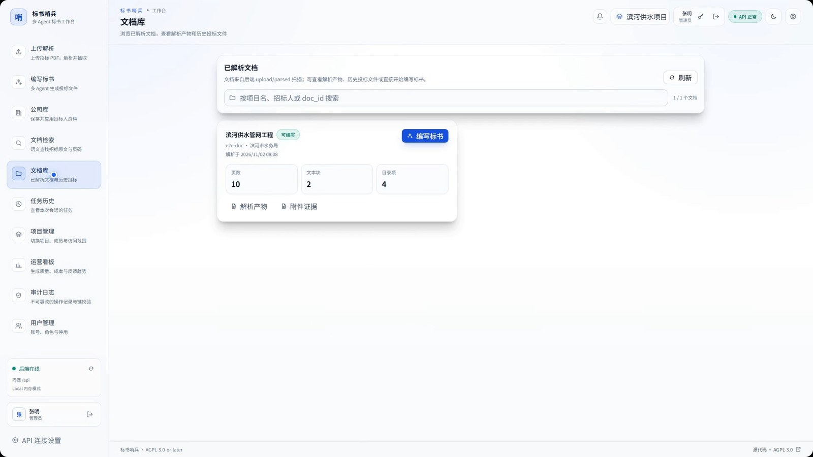
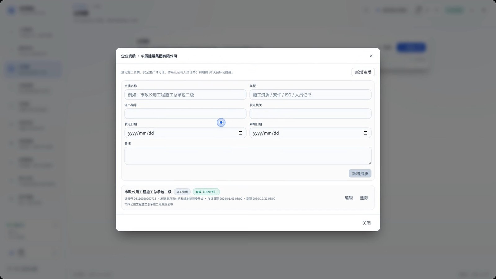
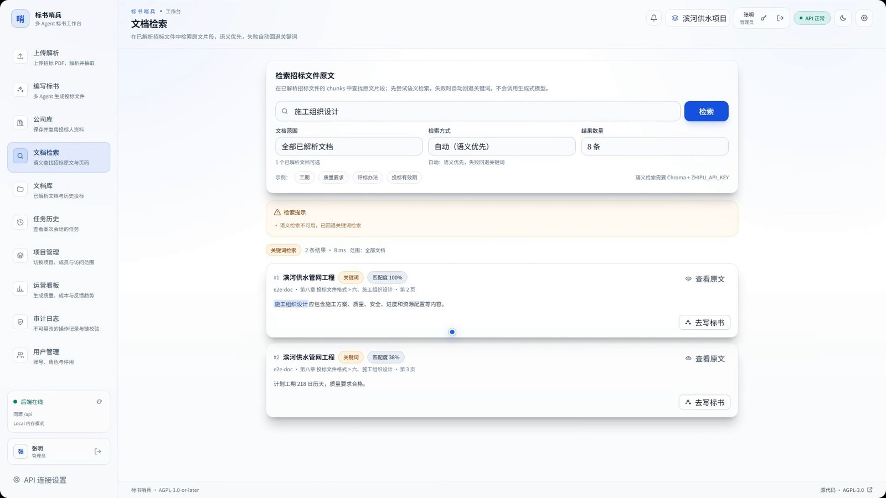
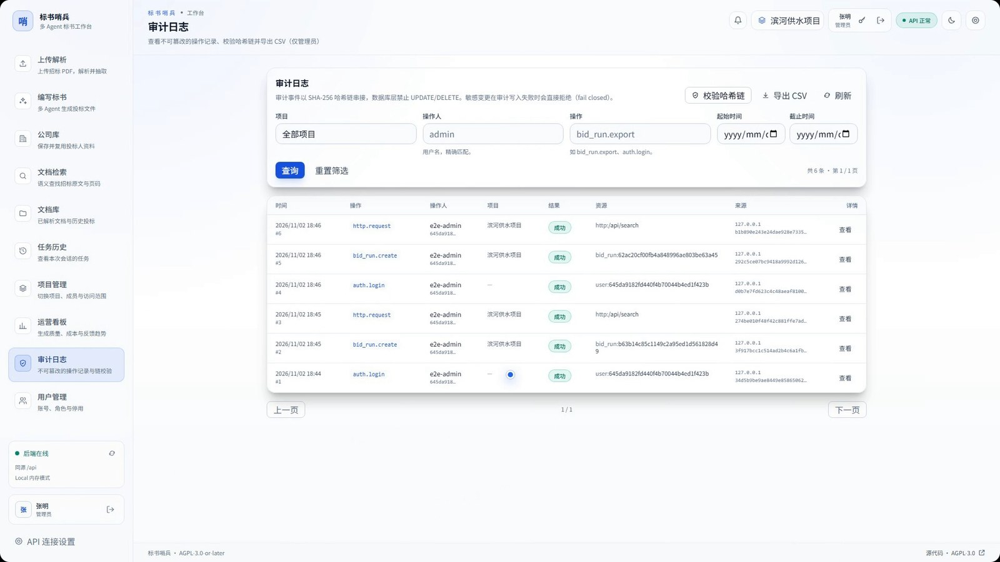

# 产品介绍视频

60 秒产品介绍视频，使用浅色前端界面与合成演示数据录制，展示登录、文档库、编写大纲、企业资质、文档检索、任务历史、门禁合规与审计日志。

- ▶ [在线播放（GitHub Pages）](https://lj105183000.github.io/much-agents/presentation/)
- [下载 MP4（1080p，60 秒，中文男声旁白）](biaoshu-shaobing-product-intro-1080p.mp4)

## 文件

| 文件 | 说明 |
|---|---|
| `index.html` | GitHub Pages 播放页（响应式 HTML5 播放器） |
| `biaoshu-shaobing-product-intro-1080p.mp4` | 1080p H.264/AAC 视频，约 4.6 MB |
| `biaoshu-shaobing-product-intro-poster.jpg` | 播放器封面图 |
| `screenshots/` | 产品前端界面截图（登录、文档库、编写大纲、企业资质、检索、审计） |

GitHub Pages 从 `docs/` 目录发布，因此播放页路径为 `/presentation/`。

## 前端界面截图

截图来自同一演示环境，使用合成演示数据；点击图片查看原图。

|  |  |
|---|---|
| **登录工作台**  | **文档库**  |
| **编写标书与大纲**  | **企业资质**  |
| **文档检索**  | **审计日志**  |

## 内容边界

- 视频使用合成演示数据，不含真实招标文件、投标人资料、账号口令或密钥。
- 界面与流程以录制时版本为准；具体能力以仓库代码与 `CLAUDE.md` 为准。
